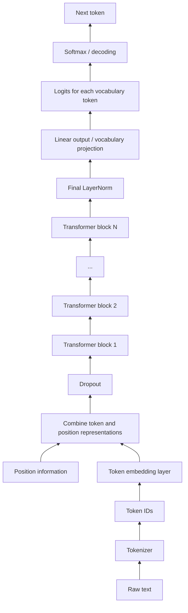
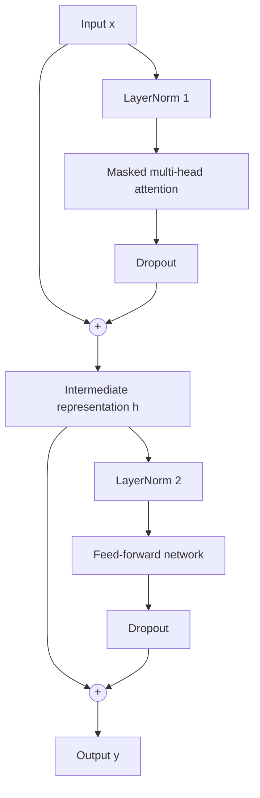

# 1. Bird's-Eye View of an LLM

## 1.1 Overall flow

A Large Language Model (LLM) converts text into numerical representations, processes those representations through Transformer blocks, and produces scores used to predict the next token.

1. Text is split into tokens by a tokenizer.
2. Tokens are converted into token IDs.
3. An embedding layer maps token IDs to dense vectors.
4. Positional information is added so the model can represent token order.
5. The representations pass through a stack of Transformer blocks.
6. A final LayerNorm and linear output projection produce vocabulary scores (logits).
7. A decoding strategy selects or samples the next token.

## 1.2 Bird's-eye architecture diagram



For autoregressive generation, the selected token is appended to the context and the model predicts the next token again. This continues until a stopping condition is met.

## 1.3 A Transformer block is repeated

Each block contains two major sublayers:

- **Masked multi-head self-attention:** allows a token to gather information from permitted earlier tokens.
- **Feed-forward network (FFN):** transforms each token's feature representation independently.

Layer normalization, dropout and residual connections support these sublayers.



The output of one Transformer block becomes the input of the next block.

## 1.4 GPT-2: a concrete example

GPT-2 is an autoregressive language model trained to predict the next token. The GPT-2 124M configuration is a useful example for understanding the architecture.

| Configuration | Value | Meaning |
|---|---:|---|
| `vocab_size` | 50,257 | Number of token IDs in the vocabulary |
| `context_length` | 1,024 | Maximum context length |
| `emb_dim` | 768 | Embedding / model dimension |
| `n_heads` | 12 | Number of attention heads in each block |
| `n_layers` | 12 | Number of Transformer blocks |
| `drop_rate` | 0.1 | Dropout probability in this configuration |
| `qkv_bias` | `false` | Whether Q, K and V projections use bias |

The model has approximately **124 million parameters**.

The dimension of each attention head is:

\[
d_{\text{head}} = \frac{\text{emb\_dim}}{\text{n\_heads}}
=\frac{768}{12}=64
\]

Each head operates on a 64-dimensional representation. The head outputs are combined to recover the model dimension of 768.

## 1.5 Configuration in Python

```python
GPT_CONFIG_124M = {
    "vocab_size": 50257,       # Vocabulary size
    "context_length": 1024,   # Maximum context length
    "emb_dim": 768,           # Embedding dimension
    "n_heads": 12,            # Number of attention heads
    "n_layers": 12,            # Number of Transformer blocks
    "drop_rate": 0.1,         # Dropout rate
    "qkv_bias": False         # Bias in Q, K and V projections
}
```

## 1.6 Language models and self-supervised learning

A language model can use text itself as the source of supervision. Given a sequence such as:

```text
Every effort moves you
```

the training objective is to predict the next token, for example:

```text
Every effort moves you forward
```

The input sequence and its next-token target are obtained from the text. Humans do not need to manually label every sentence with its meaning. This training approach is commonly called **self-supervised learning**.

## 1.7 Output layer and next-token scores

The final hidden representation is projected into a vector with one score for every vocabulary token.

For GPT-2:

\[
\text{logits shape} = (B,T,50257)
\]

Each position receives a score for each vocabulary item. During generation, the scores at the final sequence position are used to select or sample the next token.

> **Key idea:** After tokenization, the model works with numerical vectors rather than raw words. Transformer blocks repeatedly refine these vectors to make next-token prediction possible.
