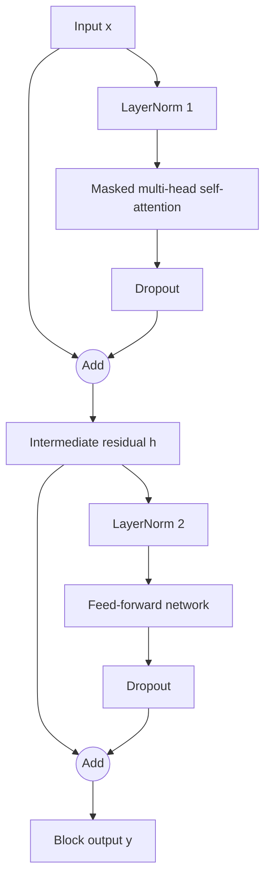
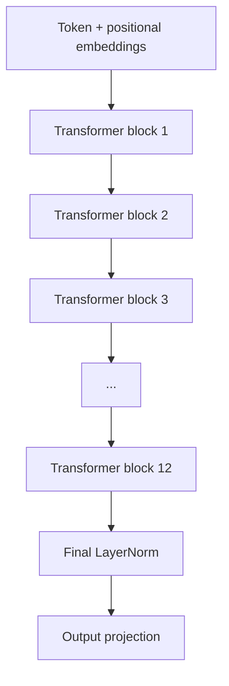

# 2. Inside a GPT-Style Transformer Block

## 2.1 Main components

A GPT-style Transformer block contains two main computational sublayers:

1. Masked multi-head self-attention
2. Position-wise feed-forward network (FFN)

It also uses:

- Layer normalization
- Dropout
- Residual / shortcut connections

Attention exchanges information across token positions. The FFN transforms the features at each token position independently.

## 2.2 Full block diagram

The following is the GPT-2-style **pre-LayerNorm** arrangement:



Mathematically:

\[
h=x+\operatorname{Dropout}
\left(\operatorname{MHA}(\operatorname{LN}_1(x))\right)
\]

\[
y=h+\operatorname{Dropout}
\left(\operatorname{FFN}(\operatorname{LN}_2(h))\right)
\]

Here, `LN` means LayerNorm and `MHA` means multi-head attention.

## 2.3 Stage A — masked multi-head attention

1. Start with the input token representations.
2. Apply LayerNorm.
3. Project the normalized representations into Query, Key and Value vectors.
4. Split the projections into multiple attention heads.
5. Calculate attention scores using Query-Key similarity.
6. Scale the scores and apply a causal mask.
7. Apply Softmax to obtain attention weights.
8. Use the attention weights to combine the Value vectors.
9. Combine the outputs of all heads and apply an output projection.
10. Apply dropout.
11. Add the original input through the residual connection.

Each token can therefore incorporate information from other tokens that it is allowed to attend to. In a causal language model, it cannot use future-token information.

## 2.4 Stage B — feed-forward network

1. Take the intermediate residual representation.
2. Apply a second LayerNorm.
3. Expand the embedding dimension using a linear layer.
4. Apply a non-linear activation such as GELU.
5. Project the expanded representation back to the original embedding dimension.
6. Apply dropout.
7. Add the FFN input through the second residual connection.

The FFN works independently at each token position. It does not perform token-to-token information exchange; attention performs that operation.

## 2.5 Why are there two residual connections?

Attention and the FFN are separate transformations. Each has its own shortcut path:

```text
Attention sublayer:
    x ───────────────────────────┐
    │                            │
    └─ LayerNorm → Attention     │
                    → Dropout ───┤
                                 + → h

Feed-forward sublayer:
    h ──────────────────────────┐
    │                           │
    └─ LayerNorm → FFN          │
                  → Dropout ────┤
                                + → y
```

The original representation can bypass each transformation and be added to the sublayer output. See [Residual Connections](04-residual-connections.md).

## 2.6 Stacking Transformer blocks

If a model has 12 Transformer blocks, the output of each block is passed to the next:



Each block receives and returns a tensor with the same model dimension. The FFN temporarily expands the feature dimension internally.

## 2.7 Normalization placement

GPT-2 uses a **pre-LayerNorm** arrangement:

- LayerNorm before masked multi-head attention
- LayerNorm before the FFN
- A final LayerNorm after the stack of Transformer blocks and before the output projection

This differs from the original Transformer paper's post-LayerNorm arrangement. Normalization placement is architecture-dependent.

## 2.8 Dropout

Dropout is a regularization technique:

- During training, selected activation values are randomly set to zero.
- It can reduce over-reliance on particular activations.
- It is generally disabled during inference/evaluation.

The GPT-2 124M configuration commonly used in these notes specifies `drop_rate = 0.1`.

> **Key takeaway:** Attention mixes information across token positions; the FFN transforms each token's features. LayerNorm supports stable activations, dropout regularizes training, and residual connections preserve direct information and gradient paths.
