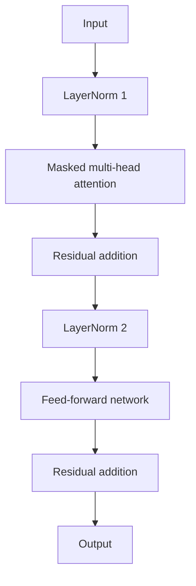

# 3. Layer Normalization in LLMs

## 3.1 Why is normalization needed?

Training deep neural networks with many layers can be challenging because of:

- Vanishing gradients
- Exploding gradients
- Unstable training dynamics
- Slow or difficult convergence

The output of one layer becomes the input to the next. If activation scales become excessively large or small, optimization can become difficult.

Layer normalization helps keep activations well-scaled and improves training stability.

## 3.2 Intuition

Consider a vector whose values have a large offset:

```text
[100, 105, 98, 102]
```

LayerNorm adjusts values using their mean and variance. The normalized values have approximately zero mean and unit variance before the learned scale and shift are applied.

The goal is not to force the final output to remain permanently at mean zero and variance one. Learnable parameters allow the network to choose a useful scale and offset.

## 3.3 Mean

For a vector containing \(n\) values:

\[
\mu=\frac{1}{n}\sum_{i=1}^{n}x_i
\]

Example:

\[
x=[2,4,6],\qquad \mu=\frac{2+4+6}{3}=4
\]

## 3.4 Variance

Using population variance:

\[
\sigma^2=\frac{1}{n}\sum_{i=1}^{n}(x_i-\mu)^2
\]

For the example:

\[
\sigma^2=
\frac{(2-4)^2+(4-4)^2+(6-4)^2}{3}
=\frac{8}{3}
\]

## 3.5 Normalize the values

\[
\hat{x}_i=\frac{x_i-\mu}{\sqrt{\sigma^2+\epsilon}}
\]

Here, \(\epsilon\) is a small positive constant added for numerical stability.

For the complete vector:

\[
\hat{x}=
\left[
\frac{x_1-\mu}{\sqrt{\sigma^2+\epsilon}},
\frac{x_2-\mu}{\sqrt{\sigma^2+\epsilon}},
\ldots
\right]
\]

## 3.6 Learnable scale and shift

LayerNorm usually has two learnable parameters:

- \(\gamma\): scale
- \(\beta\): shift

The final output is:

\[
y_i=\gamma_i\hat{x}_i+\beta_i
\]

These parameters let the model learn a useful scale and offset after normalization.

## 3.7 LayerNorm vs BatchNorm

| Property | LayerNorm | BatchNorm |
|---|---|---|
| Statistics are computed across | Features of each individual example/token | Batch dimension for each feature |
| Dependence on batch size | Independent of batch size | Depends on batch statistics |
| Common use | Transformers and sequence models | Common in convolutional networks |
| Small-batch behaviour | Generally straightforward | Batch statistics can be noisy |
| Inference behaviour | Uses the current example's feature statistics | Typically uses running statistics |

### Why is LayerNorm useful in Transformers?

A token representation can be viewed as a vector of `emb_dim` features. LayerNorm normalizes across that feature dimension for each token independently.

It does not need statistics collected across the batch. This is useful when:

- Batch sizes vary.
- Sequences have different lengths.
- Training is distributed across devices.
- Hardware resources constrain the batch size.

## 3.8 Where is LayerNorm applied in GPT-2?

In GPT-2's pre-LayerNorm architecture:

1. LayerNorm is applied before masked multi-head attention.
2. LayerNorm is applied before the feed-forward network.
3. A final LayerNorm is applied after the final Transformer block and before the output projection.



## 3.9 LayerNorm and gradient stability

LayerNorm can improve the conditioning and stability of training, but it is not a complete solution to vanishing or exploding gradients. Residual/shortcut connections provide another important mechanism for improving gradient flow. See [Residual Connections](04-residual-connections.md).

> **Key takeaway:** LayerNorm normalizes the feature values of each token representation independently of batch size. It helps keep activations well-scaled and makes Transformer training more stable.
