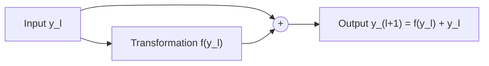
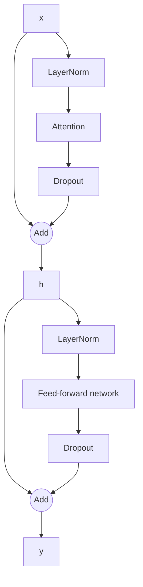

# 4. Residual / Shortcut Connections

## 4.1 What are shortcut connections?

Shortcut connections are also called:

- Skip connections
- Residual connections

They create an alternate path through a neural network so information and gradients can bypass one or more transformations.

Instead of passing the input only through a transformation, the network adds the original input to the transformation's output.

For a transformation \(f\):

\[
y_{l+1}=f(y_l)+y_l
\]

where:

- \(y_l\) is the input to the layer/block.
- \(f(y_l)\) is the transformed output.
- \(y_{l+1}\) is the residual output.

## 4.2 Why are they useful?

Deep networks can suffer from vanishing gradients. During backpropagation, gradients are propagated backwards through many layers. If the derivatives encountered along the way are repeatedly small, the gradient can become progressively smaller.

This makes earlier layers difficult to train.

Shortcut connections provide an alternative route for gradients to flow. They became especially influential through deep residual networks (ResNets) in computer vision.

## 4.3 Without a shortcut connection

Consider a normal layer:

\[
y_{l+1}=f(y_l)
\]

Using the chain rule:

\[
\frac{\partial L}{\partial y_l}
=
\frac{\partial L}{\partial y_{l+1}}
\frac{\partial y_{l+1}}{\partial y_l}
\]

Therefore:

\[
\frac{\partial L}{\partial y_l}
=
\frac{\partial L}{\partial y_{l+1}}
\frac{\partial f(y_l)}{\partial y_l}
\]

The gradient depends on the derivative of the layer transformation. If that derivative is very small, the gradient can shrink as it moves backwards.

## 4.4 With a shortcut connection

Now consider:

\[
y_{l+1}=f(y_l)+y_l
\]

Differentiate with respect to \(y_l\):

\[
\frac{\partial y_{l+1}}{\partial y_l}
=
\frac{\partial f(y_l)}{\partial y_l}+1
\]

Applying the chain rule:

\[
\frac{\partial L}{\partial y_l}
=
\frac{\partial L}{\partial y_{l+1}}
\left(
\frac{\partial f(y_l)}{\partial y_l}+1
\right)
\]

The important part is the additional **+1** term. Even if the derivative of the transformation becomes small, the shortcut path can still carry a gradient backwards.

This does not guarantee that gradients can never vanish or explode. It provides a direct path that can make optimization easier.

## 4.5 Residual connection diagram

The input follows two paths:

1. Through the transformation.
2. Directly to the addition operation.

## 4.6 Residual connections in a Transformer block

A GPT-style Transformer block has two residual connections.

### First residual connection: attention

\[
h=x+\operatorname{MHA}(\operatorname{LN}_1(x))
\]

### Second residual connection: feed-forward network

\[
y=h+\operatorname{FFN}(\operatorname{LN}_2(h))
\]

Dropout may be applied to the sublayer output before it is added to the residual stream.

## 4.7 Why are residual connections important in LLMs?

- They provide a direct path for information to move through the network.
- They provide a direct component in the gradient path during backpropagation.
- They make deep networks easier to optimize.
- They allow a sublayer to learn a refinement to the existing representation rather than reconstructing the entire representation.

## 4.8 Journal paper to explore

**Deep Residual Learning for Image Recognition** — Kaiming He et al. (2015).

This influential ResNet paper is a useful reference for understanding why shortcut connections became an important deep-learning design pattern.

> **Key takeaway:** A residual block learns a transformation and adds it to its input. The shortcut path helps information and gradients flow through deep neural networks.
