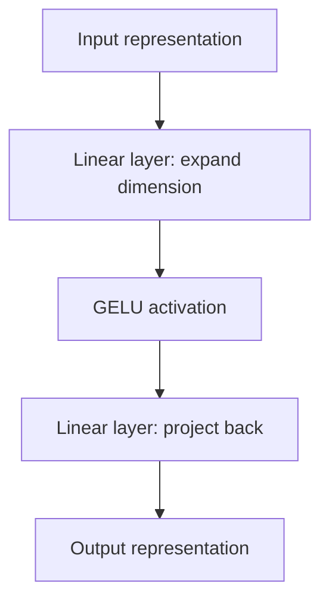

# 5. Feed-Forward Network and GELU Activation

## 5.1 What does the feed-forward network do?

The feed-forward network (FFN) is the second major sublayer inside a GPT-style Transformer block.

Attention allows tokens to exchange information. The FFN then transforms the feature representation at each token position independently.

A standard two-layer FFN has this structure:



The first linear layer expands the embedding dimension. The activation introduces non-linearity. The second linear layer projects the representation back to the original embedding dimension.

## 5.2 GPT-2 example: dimensions

For GPT-2 124M:

- Embedding dimension: `768`
- FFN hidden dimension: `3072`

The expansion factor is:

\[
\frac{3072}{768}=4
\]

Assume an input tensor has shape:

\[
(B,T,C)=(2,3,768)
\]

| Stage | Operation | Shape |
|---|---|---|
| Input | — | `(2, 3, 768)` |
| First linear layer | `768 → 3072` | `(2, 3, 3072)` |
| GELU | Element-wise activation | `(2, 3, 3072)` |
| Second linear layer | `3072 → 768` | `(2, 3, 768)` |
| Output | — | `(2, 3, 768)` |

The batch size and sequence length remain unchanged. Only the feature dimension changes inside the FFN.

## 5.3 Why expand and then project back?

The first linear layer maps each token representation into a larger feature space. The activation introduces non-linearity. The second linear layer combines the expanded features and returns the representation to the model dimension.

```text
Input:  768 features
          |
          v
Linear layer 1
          |
          v
3072 features
          |
          v
GELU activation
          |
          v
Linear layer 2
          |
          v
Output: 768 features
```

The FFN does not change the number of tokens. It changes the feature representation of each token.

## 5.4 GELU activation function

GPT-2 uses GELU (Gaussian Error Linear Unit) in its feed-forward network.

A commonly used approximation is:

\[
\operatorname{GELU}(x)
\approx
0.5x\left[
1+\tanh\left(
\sqrt{\frac{2}{\pi}}
(x+0.044715x^3)
\right)
\right]
\]

The exact GELU definition is:

\[
\operatorname{GELU}(x)=x\Phi(x)
\]

where \(\Phi(x)\) is the cumulative distribution function of the standard Gaussian distribution.

GELU can be understood as a smooth, input-dependent gate:

- Large positive inputs pass through approximately unchanged.
- Negative inputs are reduced smoothly rather than being abruptly set to zero.
- Values near zero transition smoothly.

## 5.5 ReLU activation

The ReLU activation function is:

\[
\operatorname{ReLU}(x)=\max(0,x)
\]

This means:

- If \(x\) is positive, the output is \(x\).
- If \(x\) is negative, the output is zero.

```text
Negative input  → 0
Positive input  → unchanged
```

A potential issue is the **dying ReLU problem**. If a neuron consistently receives negative inputs, its output and gradient can remain zero, making it difficult for that neuron to recover during training.

## 5.6 GELU vs ReLU

Unlike ReLU, GELU allows a small, smooth, non-zero output for negative inputs. Neurons receiving negative inputs can therefore still contribute to the learning process, although their contribution is reduced.

| Property | ReLU | GELU |
|---|---|---|
| Formula | `max(0, x)` | `x × Φ(x)` |
| Negative inputs | Exactly zero | Smoothly reduced |
| Behaviour near zero | Sharp corner | Smooth transition |
| Differentiability | Not differentiable at zero; a subgradient is used | Smooth and differentiable |
| Common use | Many neural networks | GPT-2 and many Transformer models |

### Conceptual graph

```text
Output
  ^
  |                         /
  |                       /     ReLU
  |                     /
  |-------------------/----------------> Input
  |              ____/
  |         ____/       GELU is smoother
  |________/
```

This is a conceptual sketch, not a scale-accurate plot.

## 5.7 Why can GELU be useful?

- Its smooth transition can provide useful optimization behaviour.
- Negative inputs are not abruptly discarded.
- It offers a non-linear transformation of the expanded features.

In contrast, ReLU has a sharp corner at zero and sets all negative inputs to exactly zero. The practical performance of an activation depends on the model and training setup; GELU is not universally better in every situation.

## 5.8 GELU and SwiGLU in modern LLMs

Two activation-related designs often encountered in LLMs are:

- **GELU** — used in GPT-2's feed-forward network.
- **SwiGLU** — a gated feed-forward design used in several newer Transformer architectures.

SwiGLU is not simply another name for GELU. It uses a gating mechanism and a SiLU/Swish-based activation.

A simplified expression is:

\[
\operatorname{SwiGLU}(x)
=
\operatorname{SiLU}(xW)\odot(xV)
\]

where:

- \(W\) and \(V\) are learned projection matrices.
- \(\operatorname{SiLU}(z)=z\sigma(z)\).
- \(\odot\) denotes element-wise multiplication.

The gating operation allows one projected representation to modulate another.

## 5.9 How the FFN complements attention

| Component | Main role |
|---|---|
| Self-attention | Mixes information across token positions |
| Feed-forward network | Transforms features at each token position |
| LayerNorm | Normalizes feature activations |
| Residual connection | Provides a shortcut for information and gradients |

> **Key takeaway:** The FFN expands each token's feature vector, applies a non-linear activation such as GELU, and projects it back to the model dimension. This gives the Transformer additional representational capacity beyond attention alone.
