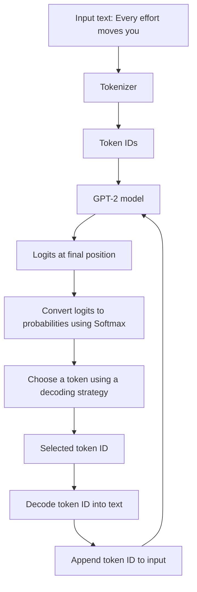

# 6. How GPT-2 Generates the Next Token

This section follows the handwritten example of a GPT-style model completing:

```text
Every effort moves you
```

The model does not generate an entire sentence in one operation. It predicts one token at a time and repeatedly feeds the generated token back into the model.

## 6.1 From input text to vocabulary scores

Assume the input text has already been tokenized and passed through the Transformer.

For GPT-2, the vocabulary contains **50,257 tokens**. At the final sequence position, the model produces a vector containing one score for every vocabulary token.

These raw scores are called **logits**.

For a batch of sequences, the output logits have shape:

\[
(B,T,V)
\]

where:

- \(B\) = batch size
- \(T\) = sequence length
- \(V\) = vocabulary size

For GPT-2 124M, \(V=50,257\).

When generating the next token, we use the logits at the **last sequence position**:

\[
\text{next-token logits} = \text{logits}[:, -1, :]
\]

The resulting shape is:

\[
(B,V)
\]

For one input sequence, this is a vector of 50,257 scores.

## 6.2 Generation workflow



## 6.3 Step-by-step next-token prediction

### Step 1 — Provide the input

```text
Every effort moves you
```

The tokenizer converts the text into token IDs. The model processes those IDs and produces logits for every vocabulary token at every sequence position.

### Step 2 — Extract the last logit vector

Only the final position is needed for the next-token prediction.

```python
next_token_logits = logits[:, -1, :]
```

The output contains one score per vocabulary token.

### Step 3 — Convert logits into probabilities

Apply Softmax:

\[
P(token_i)=
\frac{e^{z_i}}{\sum_{j=1}^{V}e^{z_j}}
\]

where \(z_i\) is the logit for token \(i\).

Softmax converts arbitrary real-valued scores into non-negative values that sum to 1.

Example (illustrative probabilities, not actual GPT-2 output):

| Candidate token | Probability |
|---|---:|
| `forward` | 0.20 |
| `together` | 0.12 |
| `you` | 0.001 |
| Other vocabulary tokens | Remaining probability |

### Step 4 — Select a token

A decoding strategy chooses the next token from the probability distribution.

Common strategies include:

- **Greedy decoding:** choose the token with the highest probability.
- **Sampling:** randomly sample a token according to the probability distribution.
- **Top-k sampling:** sample only from the `k` highest-probability tokens.
- **Top-p (nucleus) sampling:** sample from the smallest set of tokens whose cumulative probability reaches a chosen threshold.

The choice affects the diversity and predictability of generated text.

### Step 5 — Convert the token ID back to text

The selected token ID is decoded by the tokenizer.

For illustration, suppose the selected token is:

```text
forward
```

The sequence becomes:

```text
Every effort moves you forward
```

### Step 6 — Append and repeat

Append the selected token ID to the existing input IDs. Pass the updated sequence through the model again to predict the next token.

This process repeats until:

- A maximum number of new tokens is generated.
- The model emits an end-of-sequence token, where applicable.
- Another stopping condition is reached.

> **Important:** The model predicts tokens, not necessarily complete words. A word may be represented by one token or split into multiple tokens, depending on the tokenizer.

## 6.4 Why does the model use the last position?

A causal language model is trained so that the representation at position \(t\) can use the current and previous tokens, but not future tokens.

Therefore, the final position represents the context available so far and is used to predict the next token.

## 6.5 Logits are not probabilities

- **Logits:** raw, unnormalized scores produced by the output layer. They can be positive, negative or zero.
- **Probabilities:** normalized values produced by Softmax. Each value lies between 0 and 1, and all values sum to 1.

The largest logit corresponds to the largest Softmax probability, but the numerical values are not the same.

> **Key takeaway:** GPT-style generation is an autoregressive loop: process the current context, obtain next-token logits, convert them into probabilities, select a token, append it, and repeat.
