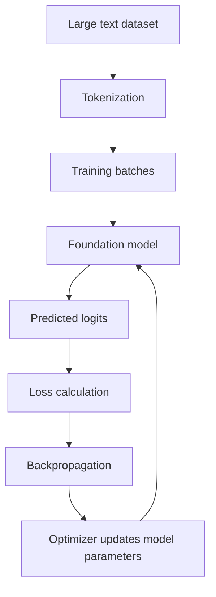

# 7. Training an LLM and Understanding the Loss Function

## 7.1 From a foundation model to a trained model

A language model learns from large collections of text. During pretraining, the model repeatedly predicts the next token and compares its prediction with the actual next token in the training data.

A simplified training flow is:



The training loop repeats over many batches and many iterations.

The model's parameters are adjusted to reduce the prediction error measured by the loss function.

## 7.2 What is a batch?

A batch is a group of training examples processed together.

For example, imagine two batches, each containing three training examples:

```text
Batch 1: [P11, P12, P13]
Batch 2: [P21, P22, P23]
```

Each example is passed through the model to produce predictions. The model compares those predictions with the correct next-token targets.

The loss is calculated from the predictions and targets, and the optimizer uses the resulting gradients to update the model parameters.

In practice, language-model training batches usually contain token sequences, and the loss is calculated over many token positions.

## 7.3 What does the model learn?

For each context, the model produces a probability distribution over the vocabulary.

The correct next token is the **target token**. Training encourages the model to assign a higher probability to that target.

For example:

```text
Context: Every effort moves you
Target:  forward
```

The model may initially assign a low probability to `forward`. The loss penalizes this prediction. During training, the parameters are updated so that the correct next token receives a higher probability in similar contexts.

## 7.4 From logits to cross-entropy loss

The conceptual sequence is:

1. **Logits:** the model produces raw scores for vocabulary tokens.
2. **Probabilities:** Softmax converts logits into a probability distribution.
3. **Target probability:** identify the probability assigned to the correct next token.
4. **Log probability:** take the logarithm of that probability.
5. **Negative log probability:** negate it to obtain the loss for that prediction.
6. **Average:** average the loss over the relevant tokens and examples.

For a single target token with predicted probability \(p_{\text{target}}\):

\[
L=-\log(p_{\text{target}})
\]

If the model assigns a high probability to the correct token, the loss is low. If it assigns a low probability, the loss is high.

### Example

| Probability assigned to correct token | Negative log-likelihood (natural log) |
|---:|---:|
| 1.00 | 0.000 |
| 0.80 | 0.223 |
| 0.50 | 0.693 |
| 0.20 | 1.609 |
| 0.01 | 4.605 |

The loss approaches zero as the probability assigned to the correct token approaches one. It grows as that probability approaches zero.

## 7.5 Cross-entropy loss

For a single prediction with a one-hot target distribution:

\[
L=-\sum_{i=1}^{V} y_i\log(p_i)
\]

where:

- \(V\) = vocabulary size
- \(y_i\) = target value for vocabulary item \(i\)
- \(p_i\) = predicted probability for vocabulary item \(i\)

Because the target is one-hot, only the correct token contributes:

\[
L=-\log(p_{\text{target}})
\]

For a batch of \(N\) target tokens, the mean loss is:

\[
L_{\text{mean}}=
-\frac{1}{N}
\sum_{n=1}^{N}
\log(p_{n,\text{target}})
\]

In a language model, the average is generally taken over the valid target-token positions. Padding or ignored positions may be excluded.

## 7.6 Why is it called cross-entropy?

Cross-entropy measures the difference between a target probability distribution and the model's predicted probability distribution.

For target distribution \(q\) and predicted distribution \(p\):

\[
H(q,p)=-\sum_i q_i\log(p_i)
\]

In next-token training, the target distribution is commonly one-hot, so this becomes the negative log probability of the correct token.

## 7.7 PyTorch implementation

PyTorch's `CrossEntropyLoss` expects raw logits and target class indices. It internally combines the log-Softmax and negative log-likelihood calculations.

```python
import torch
import torch.nn as nn

# Example: 2 predictions, 4 possible classes
logits = torch.tensor([
    [2.0, 1.0, 0.1, -1.0],
    [0.2, 0.5, 2.0, 0.1]
])

# Correct class index for each prediction
targets = torch.tensor([0, 2])

loss_fn = nn.CrossEntropyLoss()
loss = loss_fn(logits, targets)

print(loss.item())
```

Do **not** apply Softmax before passing logits to `nn.CrossEntropyLoss`; the function performs the required log-Softmax operation internally.

## 7.8 Training loop: conceptual pseudocode

```python
for batch in training_data:
    inputs, targets = batch

    # Forward pass
    logits = model(inputs)

    # Compare predictions with correct next-token targets
    loss = loss_fn(
        logits.reshape(-1, logits.size(-1)),
        targets.reshape(-1)
    )

    # Clear old gradients
    optimizer.zero_grad()

    # Backpropagation
    loss.backward()

    # Update model parameters
    optimizer.step()
```

This is a simplified illustration. A complete implementation also handles batching, device placement, validation, checkpointing and other training details.

## 7.9 Backpropagation and parameter updates

After calculating the loss:

1. Backpropagation calculates gradients of the loss with respect to model parameters.
2. The optimizer uses these gradients to update the parameters.
3. The model makes a new prediction with the updated parameters.
4. The process repeats over many batches.

The objective is to reduce the loss on the training data while retaining the ability to generalize to unseen data.

> **Key takeaway:** The loss function tells the model how wrong its next-token prediction was. Cross-entropy penalizes the model when it assigns a low probability to the correct next token. Backpropagation and an optimizer use this signal to improve the model.
