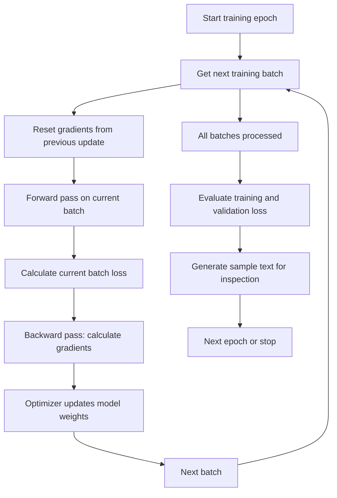

# 9. Training an LLM: The Training Loop

This chapter connects the loss-function discussion to the actual process of training a language model in PyTorch.

## 9.1 Training across epochs and batches

Training usually consists of multiple **epochs**. One epoch is one complete pass through the training dataset.

Within each epoch, the dataset is divided into **batches**. The number of batches depends on the dataset size and batch size:

\[
\text{Number of batches per epoch}
=
\left\lceil
\frac{\text{Number of training examples}}{\text{Batch size}}
\right\rceil
\]

For every batch, the model performs a forward pass, calculates the loss, computes gradients and updates its parameters.

## 9.2 The training loop



The steps are:

1. **For each training epoch:** one complete pass over the training dataset.
2. **For each batch in the training set:** retrieve the next batch of examples.
3. **Reset gradients:** clear gradients left over from the previous optimization step.
4. **Calculate the current batch loss:** run the model on the current batch and compare predictions with targets.
5. **Backward pass:** calculate the loss gradients using backpropagation.
6. **Update model weights:** use the optimizer and calculated gradients to update the parameters.
7. **Print training and validation losses:** monitor how the model is learning and whether it generalizes.
8. **Generate sample text:** inspect generated output to get a qualitative sense of model behavior.

The forward pass, loss calculation, backward pass and optimizer update are the core steps of neural-network training.

## 9.3 Why reset gradients?

PyTorch accumulates gradients by default. Therefore, gradients should normally be cleared before calculating gradients for the next batch.

```python
optimizer.zero_grad()
```

Without this step, gradients from previous batches would be added to the current gradients unintentionally.

## 9.4 Simplified PyTorch training loop

```python
for epoch in range(num_epochs):

    model.train()

    for input_batch, target_batch in train_loader:

        # 1. Clear gradients from the previous batch
        optimizer.zero_grad()

        # 2. Forward pass
        logits = model(input_batch)

        # 3. Calculate loss
        loss = loss_fn(
            logits.reshape(-1, logits.size(-1)),
            target_batch.reshape(-1)
        )

        # 4. Backward pass
        loss.backward()

        # 5. Update model parameters
        optimizer.step()

    # Evaluate after completing the epoch
    train_loss = evaluate(model, train_loader)
    val_loss = evaluate(model, val_loader)

    print(
        f"Epoch {epoch + 1}: "
        f"train loss = {train_loss:.4f}, "
        f"validation loss = {val_loss:.4f}"
    )

    # Generate a sample for qualitative inspection
    generate_sample_text(model)
```

This is conceptual code. The `evaluate()` and `generate_sample_text()` functions need to be implemented for the particular model and dataset.

## 9.5 Training loss versus validation loss

- **Training loss** measures how well the model predicts tokens from the data used to update its parameters.
- **Validation loss** measures performance on held-out data that is not used for gradient updates.

Validation loss helps identify overfitting. If training loss continues to decrease while validation loss begins to increase, the model may be memorizing the training data rather than improving generalization.

## 9.6 Why generate sample text during training?

Loss values are useful quantitative measurements, but they do not tell the whole story. Periodically generating text allows us to inspect:

- Whether the output is coherent.
- Whether the model is learning the expected style or task.
- Whether the output is repetitive or nonsensical.
- How generation quality changes across training.

> **Key takeaway:** Training is an iterative process over epochs and batches. Each batch contributes a loss signal; backpropagation calculates gradients, and the optimizer updates the model parameters.
