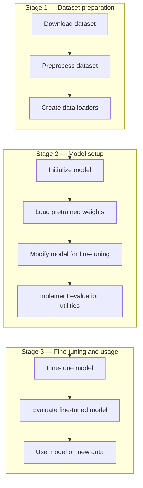

# 10. Dataset Preparation, Batching and Padding

Before training or fine-tuning an LLM, the raw dataset must be converted into a format the model can process.

## 10.1 Three stages of a model-training workflow

A useful high-level workflow has three stages.



The stages are:

### Stage 1 — Dataset preparation

1. Download the dataset.
2. Preprocess the dataset.
3. Create data loaders.

### Stage 2 — Model setup

4. Initialize the model.
5. Load pretrained weights.
6. Modify the model for the intended fine-tuning task.
7. Implement evaluation utilities.

### Stage 3 — Fine-tuning and usage

8. Fine-tune the model.
9. Evaluate the fine-tuned model.
10. Use the model on new data.

## 10.2 Handling text messages of varying lengths

Text examples do not necessarily contain the same number of tokens. However, a batch is generally represented as a rectangular tensor, so sequences in a batch need a common length.

There are two common approaches.

### Option 1 — Truncation

Truncate every sequence to a chosen maximum length.

For example, if the maximum sequence length is 8 tokens, any sequence longer than 8 tokens is shortened.

**Advantage:** predictable memory use and sequence length.

**Disadvantage:** information beyond the truncation point is lost.

### Option 2 — Padding

Pad shorter sequences until they reach a common length, often the length of the longest sequence in the batch or a configured maximum.

For example:

```text
Sequence 1: [A, B, C, PAD, PAD]
Sequence 2: [D, E, F, G, H]
Sequence 3: [I, J, K, PAD, PAD]
```

Padding allows sequences of different lengths to be processed together.

## 10.3 Padding tokens and attention masks

A padding token is a special token added to make sequences the same length. The model should not treat padding as ordinary content.

An attention mask identifies which positions contain real tokens and which positions are padding. The exact mask convention depends on the model and implementation.

For causal language-model training, the loss must also ignore padding positions. Otherwise, the model may be trained to predict padding tokens as if they were real targets.

## 10.4 Padding targets with an ignore index

In PyTorch, `torch.nn.functional.cross_entropy` supports an `ignore_index` argument.

A common convention is to replace padded target positions with `-100`:

```python
import torch.nn.functional as F

loss = F.cross_entropy(
    logits.reshape(-1, logits.size(-1)),
    targets.reshape(-1),
    ignore_index=-100
)
```

Positions whose target is `-100` do not contribute to the loss.

> **Important:** `-100` is an ignore label used for the loss calculation. It is not a token ID that should be fed into the model as an input token.

## 10.5 Padding direction

Padding can be applied on the left or right, depending on the model and task.

For the common training setup in which sequences are padded on the right:

```text
[real token, real token, real token, PAD, PAD]
```

For generation in a batch, left padding may be useful in some implementations so that the final position of each sequence is aligned. Follow the requirements of the model and its attention-mask implementation.

> **Key takeaway:** Dataset preparation converts raw text into tokenized examples and batches. Truncation limits sequence length; padding makes shorter sequences fit the batch. Padding positions must be handled correctly by attention masks and loss masking.
