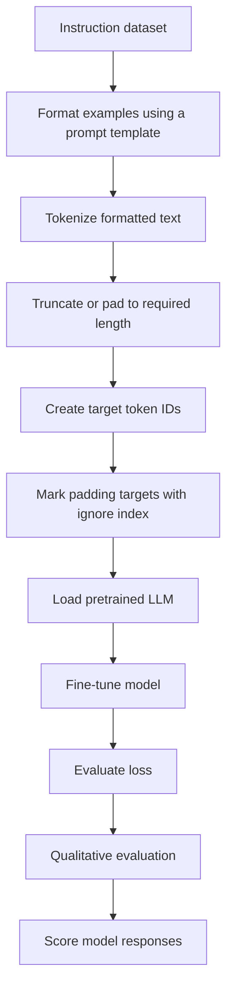

# 11. Instruction Fine-Tuning and LLM Evaluation

## 11.1 Why instruction fine-tuning?

Pretrained language models are generally trained to continue text. They can be good at text completion but may struggle to follow explicit instructions reliably.

For example, a pretrained model may continue a sentence naturally but struggle with requests such as:

- Correct the grammar in this sentence.
- Convert this sentence into passive voice.
- Summarize the following paragraph.
- Answer the question in a specified format.

**Instruction fine-tuning** adapts a pretrained model using examples that explicitly pair instructions with desired responses.

This is also called **supervised instruction fine-tuning** when the training examples provide the expected output.

## 11.2 What does an instruction dataset look like?

A simplified example:

```json
{
  "instruction": "Convert this sentence into passive voice.",
  "input": "The engineer designed the controller.",
  "output": "The controller was designed by the engineer."
}
```

The exact fields depend on the dataset. Some examples contain only an instruction and response, while others also contain an input or context.

The model is trained to produce the expected response given the instruction and any accompanying input.

## 11.3 Instruction fine-tuning workflow



The preparation and training steps are:

1. Format the data using a prompt template.
2. Tokenize the formatted data.
3. Adjust sequences to the required length using truncation or padding.
4. Create target token IDs for training.
5. Replace padding positions in the targets with an ignore index.
6. Load the pretrained LLM.
7. Fine-tune the model.
8. Evaluate the loss.
9. Qualitatively evaluate and score the model's responses.

## 11.4 Alpaca-style prompt templates

The Stanford Alpaca instruction-following dataset popularized a simple prompt format for instruction tuning.

A simplified Alpaca-style template is:

```text
Below is an instruction that describes a task.
Write a response that appropriately completes the request.

### Instruction:
{instruction}

### Input:
{input}

### Response:
{output}
```

If an example does not have a separate input field, the input section can be omitted.

A prompt template converts structured dataset fields into a consistent text format. The formatted text is then tokenized.

## 11.5 Target tokens and loss masking

In instruction fine-tuning, the model is typically trained to predict the response tokens. Depending on the training objective, the prompt tokens may be masked out of the loss so that only response tokens contribute.

For example:

```text
Prompt:   ### Instruction: Convert this sentence to passive voice.
Response: ### Response: The controller was designed by the engineer.
```

The input contains both prompt and response context, but the target labels can be configured so that the loss is calculated only over the response portion.

Padding target positions are also ignored.

In PyTorch:

```python
import torch.nn.functional as F

loss = F.cross_entropy(
    logits.reshape(-1, logits.size(-1)),
    targets.reshape(-1),
    ignore_index=-100
)
```

Here, `-100` is the conventional ignore index. The target-building code must assign it to positions that should not contribute to the loss, such as padding and, when appropriate, prompt tokens.

## 11.6 How are instruction-tuned LLMs evaluated?

There are several complementary approaches.

### 1. Short-answer and multiple-choice benchmarks

Benchmarks such as **MMLU (Massive Multitask Language Understanding)** evaluate knowledge and reasoning across many subjects using multiple-choice questions.

These benchmarks test selected capabilities, but they do not fully measure conversational usefulness or instruction-following quality.

### 2. Human preference comparisons

Human evaluators compare responses from different models and indicate which response is better.

For example, a chatbot arena can collect human preferences between model outputs.

Human preference evaluation can capture qualities such as helpfulness, clarity and relevance that are difficult to represent with a single automatic metric.

### 3. Automated conversational evaluation

Another LLM, acting as a judge, can evaluate responses against a rubric or reference answer.

For example, GPT-4 has been used as an automated evaluator in approaches such as **AlpacaEval**.

Automated evaluation can be scalable, but it may inherit biases from the judge model and should not be treated as a perfect substitute for human evaluation.

## 11.7 A complete evaluation workflow

A practical evaluation process can combine:

- **Quantitative evaluation:** validation loss, perplexity and task-specific benchmark scores.
- **Qualitative evaluation:** inspect generated responses for correctness, relevance, coherence and instruction following.
- **Human evaluation:** collect preference judgments when response quality is subjective.
- **Automated evaluation:** use a consistent rubric and, where appropriate, an LLM judge.

> **Key takeaway:** Instruction fine-tuning teaches a pretrained model to respond to explicit instructions using supervised input-output examples. Evaluation should combine numerical metrics with qualitative and human judgments.
