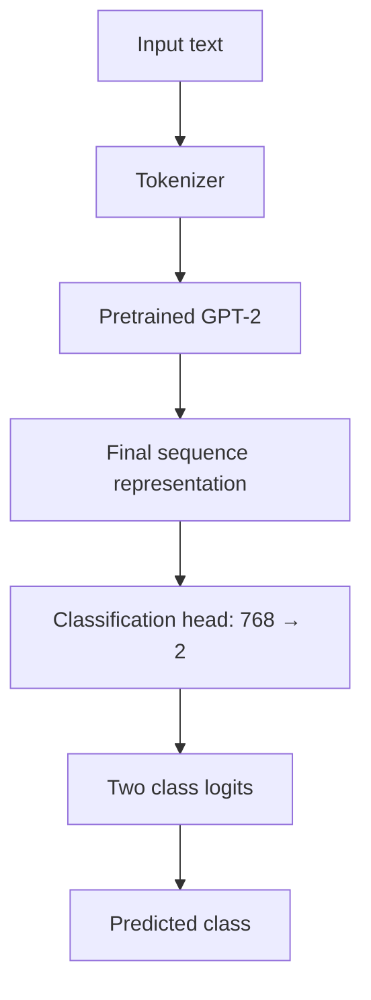

# 12. Fine-Tuning an LLM for Classification

Fine-tuning does not always mean teaching a model to generate a response. A pretrained language model can also be adapted to classify text into a fixed set of labels.

## 12.1 What is classification fine-tuning?

Classification fine-tuning trains a model to recognize a specific set of classes.

Examples include:

- Spam versus not spam.
- Positive, neutral or negative sentiment.
- Support request categories.
- Topic classification.

For a binary spam classifier, the two output classes could be:

```text
Class 0: Not spam
Class 1: Spam
```

## 12.2 Replacing the language-model output head

Consider GPT-2 small, whose hidden representation size is 768 and whose vocabulary contains 50,257 tokens.

The original language-model output head maps:

\[
768 \rightarrow 50,257
\]

This produces one logit for every token in the vocabulary.

For a binary classification task, replace the original output head with a classification head:

\[
768 \rightarrow 2
\]

The two output units represent the two class scores.

Conceptually:



The precise representation used for classification depends on the model implementation. For a causal GPT-style model, one common approach is to use the final non-padding token representation.

## 12.3 Which layers should be fine-tuned?

It is not always necessary to fine-tune every parameter of a pretrained model.

The lower layers often capture broadly useful language features and representations. Depending on the dataset and task, they may be retained or frozen while selected upper layers and the classification head are trained.

A possible strategy is:

- Train the classification head.
- Fine-tune the final Transformer block.
- Fine-tune the final LayerNorm module.
- Freeze the remaining pretrained parameters.

This is one possible configuration, not a universal rule. The best choice depends on the dataset size, task complexity and available compute.

## 12.4 Freezing model parameters

Freezing a parameter means preventing its value from being updated during training.

In PyTorch:

```python
for param in model.parameters():
    param.requires_grad = False
```

Then enable gradients for the modules that should be trained:

```python
for param in model.classification_head.parameters():
    param.requires_grad = True
```

The exact module names depend on the model implementation.

## 12.5 Classification loss and accuracy

For classification, we have:

- **Target:** the true class label.
- **Prediction:** the model's predicted class scores (logits).

Cross-entropy loss measures how much probability the model assigns to the correct class.

For a batch of examples:

\[
L=-\frac{1}{N}\sum_{n=1}^{N}
\log(p_{n,y_n})
\]

where \(y_n\) is the correct class for example \(n\).

Accuracy is the fraction of predictions that match the true labels:

\[
\text{Accuracy}=
\frac{\text{Number of correct predictions}}
{\text{Total number of predictions}}
\]

The loss provides a training signal, while accuracy provides an intuitive measure of classification performance. For imbalanced datasets, precision, recall and F1-score are also important.

## 12.6 Updating model weights

Backpropagation calculates the gradient of the loss with respect to trainable weights:

\[
\frac{\partial L}{\partial W}
\]

A basic gradient-descent update is:

\[
W_{\text{new}}=
W_{\text{old}}-\eta\frac{\partial L}{\partial W}
\]

where \(\eta\) is the learning rate.

An optimizer such as AdamW performs parameter updates using its own update rule and state.

> **Key takeaway:** Classification fine-tuning replaces the vocabulary prediction head with a task-specific classification head. You can train only selected layers and freeze the rest of the pretrained model to reduce the number of trainable parameters.
