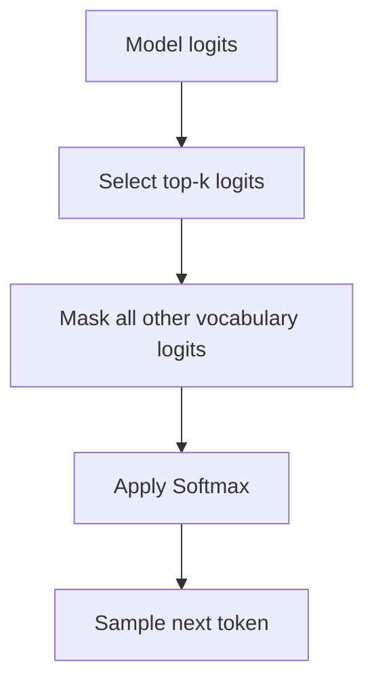

# 13. Sampling Strategies: Temperature and Top-k

Once a language model produces next-token logits, a decoding strategy determines how the next token is selected.

Greedy decoding always selects the token with the highest probability. This is predictable, but it can make generated text repetitive or less diverse.

Sampling introduces controlled randomness by drawing a token from a probability distribution.

Two useful techniques are **temperature scaling** and **top-k sampling**.

## 13.1 Temperature scaling

Temperature controls the sharpness of the probability distribution used for sampling.

Before this, the model produces logits:

\[
z_1,z_2,\ldots,z_V
\]

Temperature scaling divides each logit by a positive temperature value \(T\):

\[
z_i'=\frac{z_i}{T}
\]

The scaled logits are then passed through Softmax:

\[
P(token_i)=
\frac{\exp(z_i/T)}
{\sum_{j=1}^{V}\exp(z_j/T)}
\]

The resulting probability distribution is used to sample the next token.

### Low temperature

When \(T\) is small and positive:

- The distribution becomes sharper.
- High-probability tokens become more dominant.
- Sampling becomes more predictable.
- Diversity generally decreases.

### High temperature

When \(T\) is large:

- The distribution becomes flatter.
- Lower-probability tokens receive relatively more probability.
- Sampling becomes more varied.
- The chance of selecting an unsuitable token can increase.

| Temperature | Typical effect |
|---|---|
| \(T \rightarrow 0^+\) | Approaches greedy selection |
| \(T = 1\) | Original Softmax distribution |
| \(T > 1\) | Flatter distribution and more diversity |
| \(0 < T < 1\) | Sharper distribution and less diversity |

Temperature must be positive. A temperature of zero is not used directly in the division; greedy decoding can be used instead.

## 13.2 Entropy and temperature

Entropy measures uncertainty in a probability distribution:

\[
H(P)=-\sum_{i=1}^{V}P_i\log(P_i)
\]

For a fixed set of non-identical logits, increasing temperature generally makes the distribution flatter and increases entropy. Decreasing temperature generally makes it sharper and decreases entropy.

This is the intuition behind the note:

> Increasing temperature generally increases the randomness of token selection.

The exact entropy change depends on the logits and distribution.

## 13.3 Top-k sampling

Top-k sampling restricts token selection to the `k` most likely tokens.

Instead of sampling from the entire vocabulary:

1. Start with the model's logits.
2. Identify the `k` largest logits.
3. Keep those logits and mask all other logits.
4. Apply Softmax to the remaining logits.
5. Sample from the resulting distribution.



This prevents the model from sampling from the long tail of very unlikely tokens.

## 13.4 Combining temperature and top-k

Temperature and top-k can be combined.

One common sequence is:

```text
Model logits
    ↓
Apply temperature scaling
    ↓
Keep top-k logits and mask the rest
    ↓
Apply Softmax
    ↓
Sample from the resulting distribution
```

The exact order can vary between implementations. The important point is that temperature changes the relative sharpness of the distribution, while top-k restricts the candidate set.

## 13.5 PyTorch example

```python
import torch

def sample_next_token(logits, temperature=1.0, top_k=50):
    # logits has shape (batch_size, vocab_size)

    if temperature <= 0:
        raise ValueError("temperature must be positive")

    # 1. Temperature scaling
    logits = logits / temperature

    # 2. Keep only the top-k logits
    if top_k is not None:
        k = min(top_k, logits.size(-1))
        top_values, _ = torch.topk(logits, k, dim=-1)

        threshold = top_values[:, -1].unsqueeze(-1)
        logits = logits.masked_fill(logits < threshold, float("-inf"))

    # 3. Convert remaining logits to probabilities
    probabilities = torch.softmax(logits, dim=-1)

    # 4. Sample one token ID
    next_token = torch.multinomial(probabilities, num_samples=1)

    return next_token
```

This is a simplified implementation. A production generation pipeline may also include top-p sampling, repetition penalties, minimum-length constraints and end-of-sequence handling.

## 13.6 Decoding and repetition

Sampling can make output more varied, but it does not guarantee better text. Very high temperatures can produce incoherent output, while very restrictive settings can make output repetitive.

The decoding strategy should be selected according to the task:

- More deterministic output may be useful for structured or constrained responses.
- More diverse output may be useful for creative generation.
- Top-k can exclude very unlikely tokens.
- Temperature controls how strongly the model favors higher-scoring tokens.

> **Key takeaway:** Temperature controls the sharpness of the next-token probability distribution. Top-k restricts sampling to the `k` most likely candidates. Together, they provide control over the diversity and predictability of generated text.
